<div align="center">

# 🪞 MindMirror

**A calm, trilingual self-discovery app: a 20-question personality-type assessment with transparent scoring, plus trait quizzes, mood check-ins and personal analytics.**


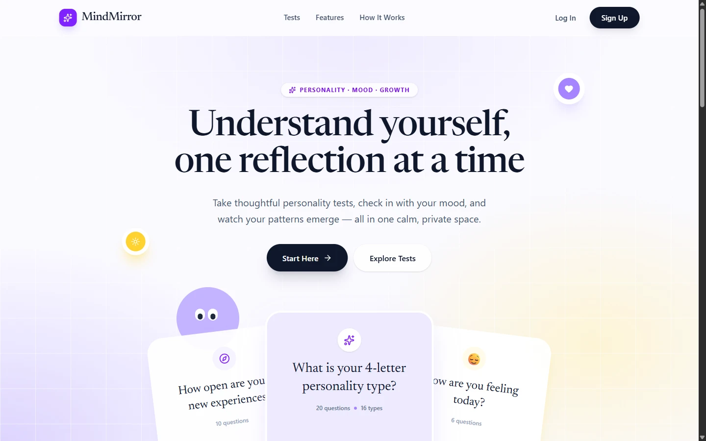

</div>

---

## Table of contents

- [Overview](#overview)
- [Screenshots](#screenshots)
- [Why MindMirror Is Different](#why-mindmirror-is-different)
- [Personality assessment methodology](#personality-assessment-methodology)
- [Research and references](#research-and-references)
- [Technology stack](#technology-stack)
- [Architecture](#architecture)
- [Authentication and Firebase](#authentication-and-firebase)
- [Security](#security)
- [Multilingual support](#multilingual-support)
- [Getting started](#getting-started)
- [Testing](#testing)
- [Project structure](#project-structure)
- [Privacy and scientific limitations](#privacy-and-scientific-limitations)
- [Copyright and license](#copyright-and-license)

---

## Overview

Most personality websites either ask you dozens of questions or hand you a four-letter code with no explanation of where it came from. MindMirror takes a different approach. It is a short, honest self-reflection tool:

- **20 original statements**, answered on a four-point scale, in **English, French or Arabic**.
- **Deterministic, transparent scoring**. The results page shows the percentage for both sides of every preference pair *and* the raw points behind them.
- **A distinct written profile for each of the 16 types**, with every letter explained in plain language.
- **Clear about its limits.** The results page itself says what the scores mean and what they do not, and it links to the type-theory sources and to independent peer-reviewed research.

Alongside the personality-type assessment, signed-in users get ten short trait quizzes, a daily mood check-in, and an analytics dashboard that charts their own results over time.

---

## Screenshots

All screenshots were captured from the running application at a consistent 1440 × 900 desktop viewport (and 390 × 844 for mobile). Signed-in screens use a **synthetic test account** (`alex.demo@example.test`) on the local Firebase emulators, so no real user data appears.

### Results that explain themselves

| Your type and what each letter means | Preference percentages and raw points |
|---|---|
| 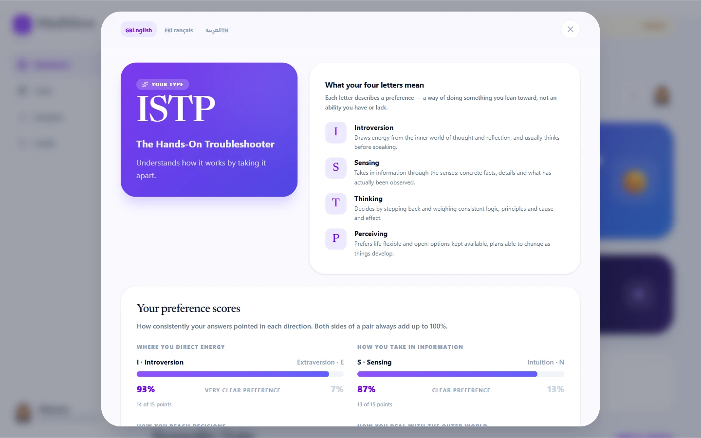 | 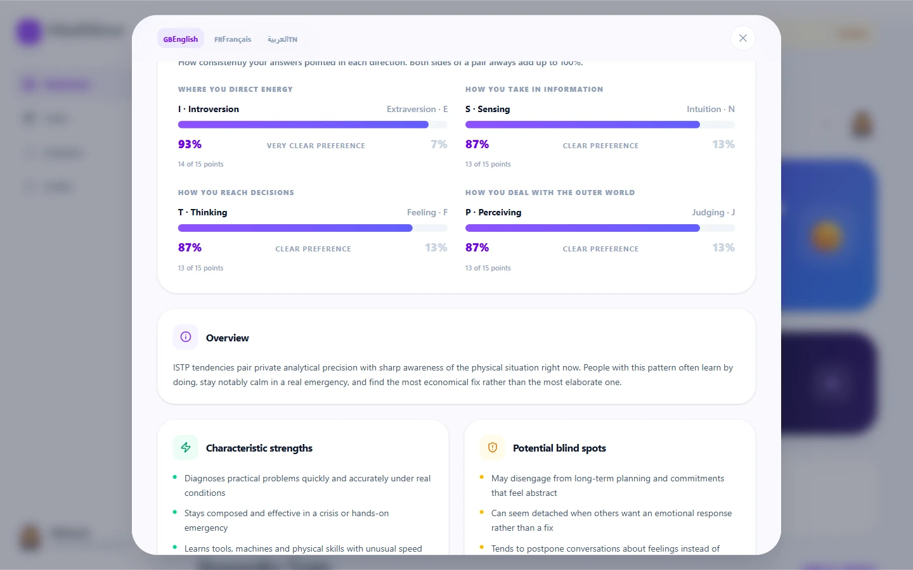 |
| **Strengths, blind spots and tendencies** | **Sources and an honest note about type** |
| 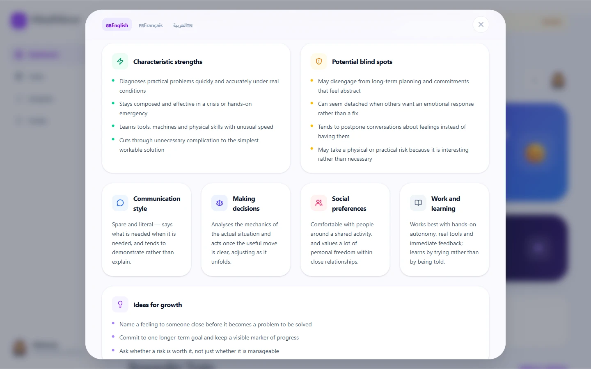 | 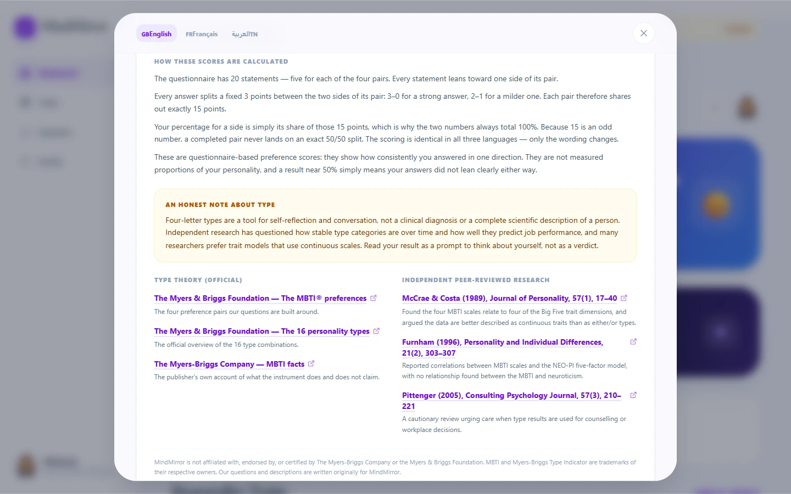 |

### One test, three languages

| English | Français | العربية (RTL) |
|---|---|---|
| 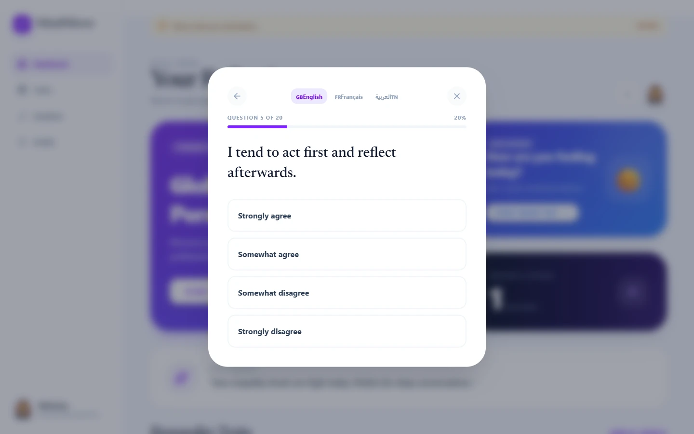 | 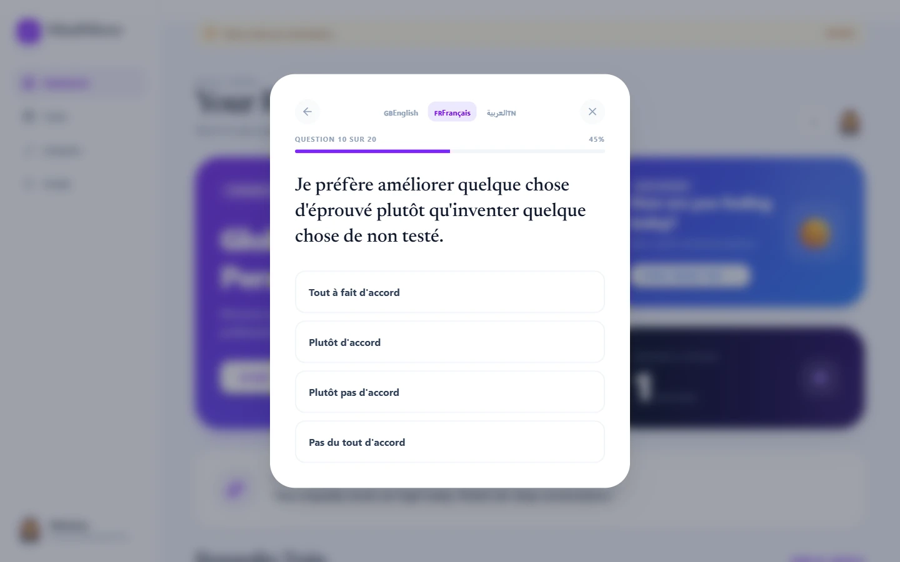 |  |

| Language choice before the test | Arabic results, fully right-to-left |
|---|---|
| 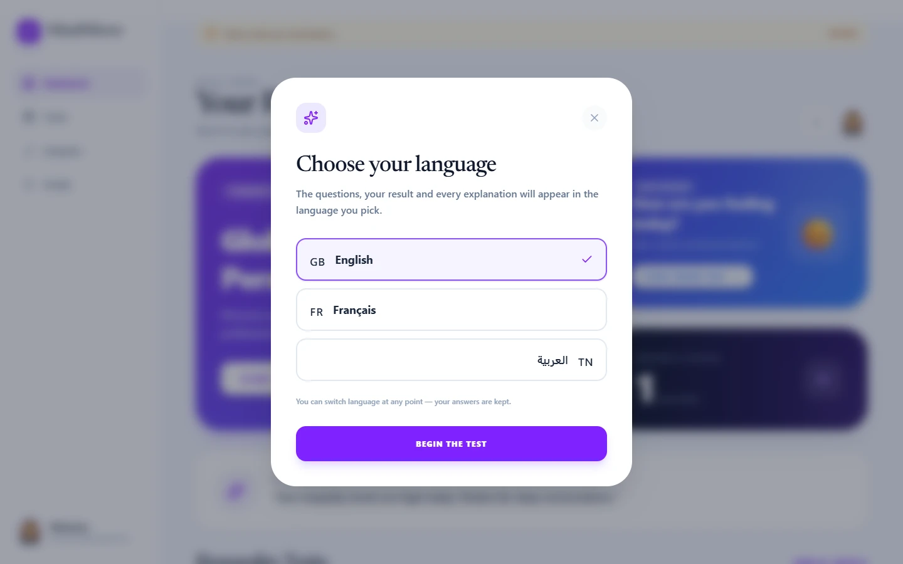 | 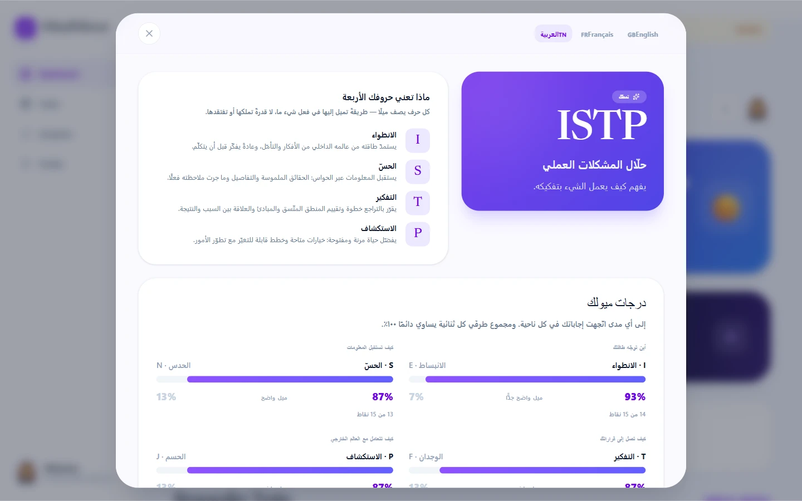 |

### Dashboard, analytics and sign-in

| Personalized dashboard | Analytics |
|---|---|
| 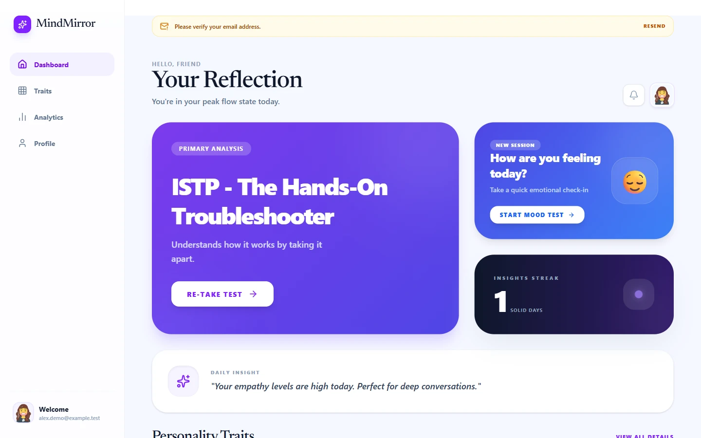 | 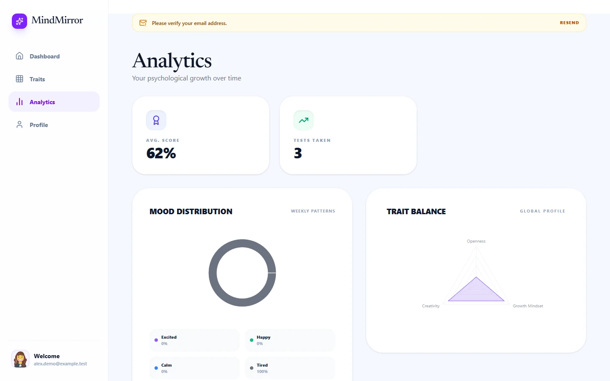 |
| **Sign in / sign up** | **Public homepage** |
| 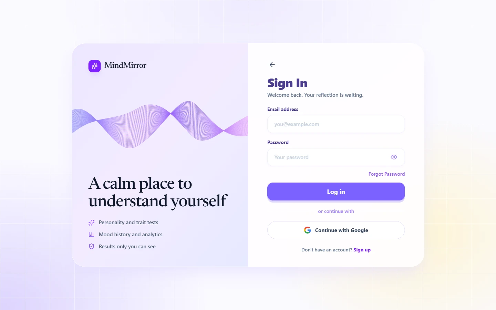 |  |

### Mobile

| Homepage | Results |
|---|---|
| 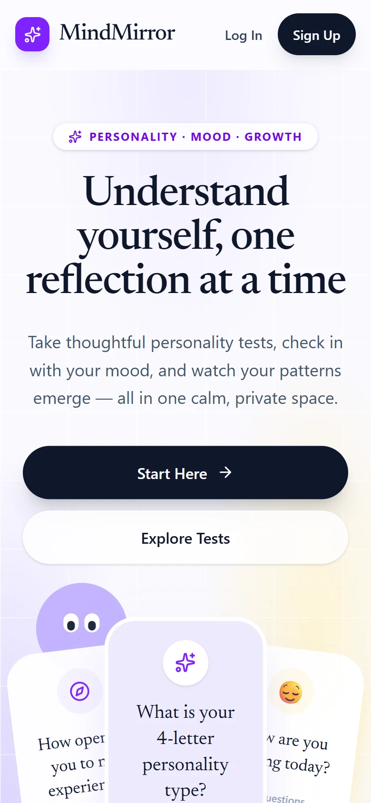 | 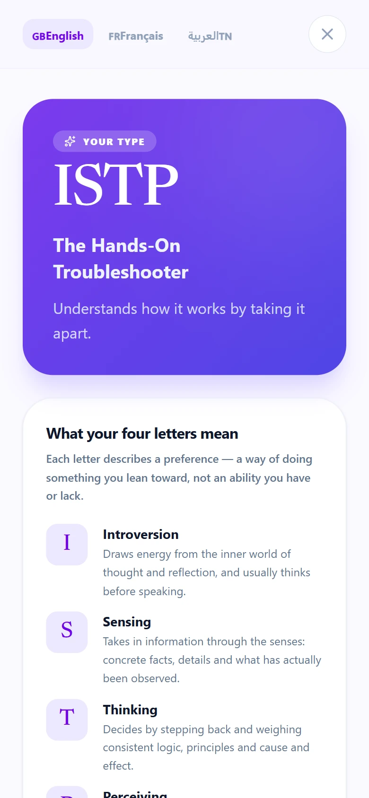 |

---

## Why MindMirror Is Different

### A. Just 20 questions

MindMirror's personality-type assessment uses **20 carefully written original statements**: no filler, and no repeated questions in disguise.

| | |
|---|---|
| **Statements** | 20 in total |
| **Per dimension** | 5 statements for each of the four preference pairs |
| **Response scale** | 4 points: *Strongly agree · Somewhat agree · Somewhat disagree · Strongly disagree* |
| **Neutral option** | None. Every answer leans one way, so every answer counts. |
| **Typical time** | A few minutes |

Many established personality questionnaires run to dozens or even hundreds of items. MindMirror is deliberately shorter, so it is easy to take and to retake. **Shorter does not mean more accurate.** A brief instrument gives you less information than a long one, and MindMirror's results should be read with that in mind (see [limitations](#privacy-and-scientific-limitations)).

### B. Transparent, research-informed scoring

MindMirror does not pick a four-letter type at random, and it does not hide how it reached a result. The scoring code is in [`src/mbti/scoring.ts`](src/mbti/scoring.ts):

- It processes **your actual answers**. Each statement is keyed to one side of a pair (for example *E*), and agreeing moves the score toward that side.
- It evaluates **four preference dimensions**: E/I, S/N, T/F and J/P.
- It is **deterministic**. The same answers always give the same type and the same percentages. Nothing is random, and nothing is hard-coded per type.
- It shows **both percentages** for every pair. They always add up to 100%.
- It shows the **raw points** behind each percentage, for example *"14 of 15 points"*.
- It is **language-independent**. The language only changes the wording, never the weights, so the same answers give the same result in English, French or Arabic.

The type descriptions are informed by established personality-type theory (the Myers & Briggs Foundation's description of the preference pairs) and by independent research on the MBTI (see [references](#research-and-references)).

> **Important:** MindMirror's 20-question instrument is **custom and has not been psychometrically validated**. Its percentages are *preference scores*: they show how consistently you answered in one direction. They are **not** measured proportions of your personality. MindMirror makes **no claim to be more accurate** than established instruments; no comparative validation has been done. "Research-informed design" is not the same as "scientifically demonstrated accuracy".

### C. All 16 personality types

Each of the 16 types has its own written profile, in each of the three languages:

| Section | Content |
|---|---|
| Overview | What this combination of preferences tends to look like |
| Strengths | 4 characteristic strengths |
| Potential blind spots | 4 potential weaknesses |
| Communication | Typical communication tendencies |
| Decisions | Decision-making preferences |
| Social | Social tendencies |
| Work and learning | Work and learning preferences |
| Growth | 3 personal-growth suggestions |

The profiles are **written to be different from one another**, not generated from a shared template. The automated tests enforce this: no two types share an overview, tagline, nickname, strength, weakness or growth suggestion, and types that share three letters (such as ISTP and INTP) are checked to still read differently. The profiles are also checked to avoid deterministic career claims and claims that one type is better than another.

### D. Understand every letter

MindMirror never hands you an unexplained code. Every result explains each of its four letters. For example, **ISTP**:

| Letter | Preference | Meaning (as shown in the app) |
|:---:|---|---|
| **I** | Introversion | Draws energy from the inner world of thought and reflection, and usually thinks before speaking. |
| **S** | Sensing | Takes in information through the senses: concrete facts, details and what has actually been observed. |
| **T** | Thinking | Decides by stepping back and weighing consistent logic, principles and cause and effect. |
| **P** | Perceiving | Prefers life flexible and open: options kept available, plans able to change as things develop. |

Each letter describes a *preference*, a way of doing things you lean toward. It is not an ability you have or lack.

### E. Three languages

| | English | Français | العربية |
|---|:---:|:---:|:---:|
| All 20 statements translated | ✅ | ✅ | ✅ |
| Answer scale translated | ✅ | ✅ | ✅ |
| Results, letters and profiles translated | ✅ | ✅ | ✅ |
| Methodology and disclaimer translated | ✅ | ✅ | ✅ |
| Right-to-left layout | | | ✅ |

- **Switch language at any time** during the test. Your answers are kept.
- **Your language is remembered** for your next visit (in browser storage), and it is saved with your result.
- **Scoring is identical in every language**, which is covered by the automated tests.

### F. Personalized visual results

- Animated preference bars for all four dimensions
- Percentages for both sides of each pair, with the raw points behind them
- A clarity label for each preference: *slight*, *moderate*, *clear* or *very clear*
- An explanation of all four letters
- A distinct profile with strengths, potential blind spots and growth ideas
- A responsive results layout, from phone to desktop

### G. Modern authentication

- **Google Sign-In** and **email/password** accounts through Firebase Authentication
- **Password reset** by email
- **Email verification**, with a reminder banner and a *Resend* action
- **Sign-in only when it is needed.** Browsing is open to everyone, and sign-in is requested only when you start a test or open a private page.
- **Return to what you were doing.** After signing in, you go back to the action you asked for, such as the test you tried to start.

### H. Public homepage first

Visitors can look around before creating an account: the available tests, the features, and how the app works. An account is only needed to take a test, so that results have a private place to be saved.

### I. Responsive desktop and mobile experience

- A proper desktop layout with a sidebar, plus bottom navigation on mobile
- Tests open as centered dialogs on desktop and full-screen sheets on phones
- Responsive cards and typography, and support for tablet widths
- A calm, lavender-inspired visual design with smooth Motion animations

### J. Security and privacy

- **Firebase Authentication** for every private feature
- **Default-deny Firestore rules.** Anything not explicitly allowed is refused.
- **Per-user access control.** Users can only read and write their own profile, results and mood entries.
- **Field validation** on every write: exact allowed keys, types, sizes, known trait and mood ids, the 0–100 range of each percentage, supported language codes, and server timestamps
- **Verified email required to save.** Email/password accounts must verify their address before results, moods or a personality type are saved; Google accounts are unaffected
- **Security headers on Firebase Hosting:** Content Security Policy, HSTS, `nosniff`, clickjacking protection and a popup-safe opener policy
- **49 automated security-rule tests** run against the Firestore emulator
- See [Security](#security) for exactly what has been verified live

### K. Automated testing

| Suite | Result |
|---|---|
| Personality scoring and content tests (`npm run test:mbti`) | **29 passing** |
| Firestore security-rule tests (`npm run test:rules`) | **49 passing** |
| TypeScript check (`npm run lint`) | **Clean** |
| Production build (`npm run build`) | **Successful** |

**78 automated tests passing**, plus a clean type-check and a successful production build. These figures were re-run on 21 November 2026.

---

## Personality assessment methodology

The model behind MindMirror follows the four preference pairs described in Jungian type theory and by the Myers & Briggs Foundation:

| Dimension | Question it asks | Poles |
|---|---|---|
| E / I | Where do you direct your energy? | Extraversion · Introversion |
| S / N | How do you take in information? | Sensing · Intuition |
| T / F | How do you reach decisions? | Thinking · Feeling |
| J / P | How do you deal with the outer world? | Judging · Perceiving |

**Scoring, step by step**

1. Each of the 20 statements is keyed to one pole. There are 5 statements per dimension.
2. Each answer splits a fixed **3 points** between the two poles of its dimension:

   | Answer | Keyed pole | Opposite pole |
   |---|:---:|:---:|
   | Strongly agree | 3 | 0 |
   | Somewhat agree | 2 | 1 |
   | Somewhat disagree | 1 | 2 |
   | Strongly disagree | 0 | 3 |

3. Each dimension therefore always distributes exactly **15 points** (5 × 3).
4. A pole's percentage is its share of those 15 points, so the two sides of a pair always total 100%.
5. Because 15 is odd, a fully answered dimension can never tie 50/50, so there is always a preferred side.
6. The four preferred poles form the type, for example **ISTP**.
7. The clarity label comes from the winning percentage: 50–59 *slight*, 60–74 *moderate*, 75–89 *clear*, 90–100 *very clear*.

The statements are **original to MindMirror**. They are not items from the published MBTI® instrument, which is copyrighted.

---

## Research and references

MindMirror cites two kinds of sources: **type theory** (where the model comes from) and **independent peer-reviewed research** (how that model holds up). All of them are linked from the results page.

**Type theory**

| Source | How it informs MindMirror |
|---|---|
| [The Myers & Briggs Foundation — The MBTI® preferences](https://www.myersbriggs.org/my-mbti-personality-type/the-mbti-preferences/) | The four preference pairs that the statements are built around, and the basis for the letter explanations |
| [The Myers & Briggs Foundation — The 16 personality types](https://www.myersbriggs.org/my-mbti-personality-type/the-16-mbti-personality-types/) | The 16 type combinations that the profiles cover |
| [The Myers-Briggs Company — MBTI facts](https://www.themyersbriggs.com/en-us/support/mbti-facts) | The publisher's own account of what the instrument does and does not claim, which shaped MindMirror's cautious wording |

**Independent research**

| Source | How it informs MindMirror |
|---|---|
| McCrae, R. R., & Costa, P. T. (1989). Reinterpreting the Myers-Briggs Type Indicator from the perspective of the five-factor model of personality. *Journal of Personality, 57*(1), 17–40. [doi:10.1111/j.1467-6494.1989.tb00759.x](https://doi.org/10.1111/j.1467-6494.1989.tb00759.x) | Found that the four MBTI scales relate to four of the Big Five dimensions, and argued the data are better described as continuous traits than as either/or types. This is why MindMirror shows percentages and clarity levels rather than just letters. |
| Furnham, A. (1996). The big five versus the big four: the relationship between the Myers-Briggs Type Indicator (MBTI) and NEO-PI five factor model of personality. *Personality and Individual Differences, 21*(2), 303–307. [doi:10.1016/0191-8869(96)00033-5](https://doi.org/10.1016/0191-8869(96)00033-5) | Reported correlations between the MBTI scales and the five-factor model, with no MBTI relationship to neuroticism. This is why MindMirror does not present the four letters as a complete picture of a person. |
| Pittenger, D. J. (2005). Cautionary comments regarding the Myers-Briggs Type Indicator. *Consulting Psychology Journal: Practice and Research, 57*(3), 210–221. [doi:10.1037/1065-9293.57.3.210](https://doi.org/10.1037/1065-9293.57.3.210) | Urges caution when type results are used for counselling or workplace decisions. This is behind MindMirror's "honest note about type" and the absence of career prescriptions. |

> **Disclaimer.** MindMirror is an independent self-discovery application. Its custom assessment is not an official MBTI instrument, a clinical diagnostic tool, or a scientifically validated psychological assessment. MindMirror is not affiliated with, endorsed by, or certified by The Myers-Briggs Company or the Myers & Briggs Foundation. MBTI, Myers-Briggs and Myers-Briggs Type Indicator are trademarks of their respective owners.

---

## Technology stack

| Layer | Technology |
|---|---|
| UI framework | [React 19](https://react.dev/) + [TypeScript 5.8](https://www.typescriptlang.org/) |
| Build tool | [Vite 6](https://vitejs.dev/) |
| Styling | [Tailwind CSS 4](https://tailwindcss.com/) |
| Animation | [Motion](https://motion.dev/) |
| Charts | [Recharts](https://recharts.org/) |
| Icons | [lucide-react](https://lucide.dev/) |
| Notifications | [react-hot-toast](https://react-hot-toast.com/) |
| Authentication | [Firebase Authentication](https://firebase.google.com/docs/auth) (Google, email/password) |
| Database | [Cloud Firestore](https://firebase.google.com/docs/firestore) |
| Security testing | [`@firebase/rules-unit-testing`](https://www.npmjs.com/package/@firebase/rules-unit-testing) + the Firestore emulator |

---

## Architecture

MindMirror is a **client-side single-page application** with no custom backend server. The browser talks directly to Firebase, and the Firestore security rules decide what each signed-in user may read or write.

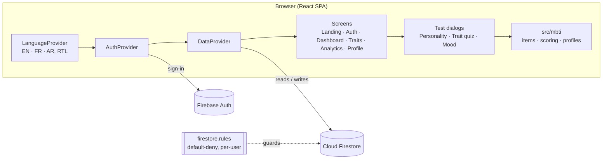

- **Routing.** A small hash router (`src/lib/navigation.ts`) keeps the public homepage, sign-in, and the private pages separate. It remembers a signed-out visitor's intended action and resumes it after sign-in.
- **Personality engine.** `src/mbti/` is UI-independent: statements (`items.ts`), scoring (`scoring.ts`), letter explanations (`dimensions.ts`), interface strings and sources (`ui.ts`), and per-language type profiles (`profiles/`).
- **Data model.** `users/{uid}` holds the profile, streak, saved type, preference percentages and language. `results` and `daily_moods` are append-only records tagged with the owner's `userId`.

---

## Authentication and Firebase

| Feature | Implementation |
|---|---|
| Google Sign-In | `signInWithPopup` with `GoogleAuthProvider` |
| Email / password | `createUserWithEmailAndPassword`, `signInWithEmailAndPassword` |
| Email verification | `sendEmailVerification` on sign-up, plus a resend banner. Email/password accounts must be verified before personal data is saved (enforced by the rules; the app explains why and refreshes the status after verification). |
| Password reset | `sendPasswordResetEmail` |
| Session-aware routing | Private pages and tests require sign-in. The intended action resumes afterwards. |
| Local emulators | `VITE_USE_EMULATORS=true` connects a dev build to the Auth and Firestore emulators. This path is excluded from production builds. |

The Firebase web configuration lives in [`firebase-applet-config.json`](firebase-applet-config.json). Those values (`apiKey`, `projectId`, …) are **public client identifiers, not secrets**, because Firebase web apps ship them in the browser bundle. Access to data is controlled by Authentication and the security rules, not by hiding this file. No Admin SDK credentials or service-account keys are used or included anywhere in this repository.

---

## Security

The rules in [`firestore.rules`](firestore.rules) enforce the following:

| Protection | Detail |
|---|---|
| Default deny | `match /{document=**} { allow read, write: if false; }` |
| Owner-only profiles | `users/{uid}` can be read and written only by that user |
| Restricted updates | Only declared fields may change, and `uid` cannot be reassigned |
| Validated personality results | `mbtiScores` must contain exactly the eight poles, each a number from 0 to 100. `mbtiType` must be a valid four-letter type. `language` must be `en`, `fr` or `ar`. |
| Validated profiles | Only declared fields; `traitsProgress` accepts only the ten trait ids with whole percentages 0–100; `streak` is a bounded integer; a new profile must use the signed-in email and start empty |
| Validated history | `results` accept only known trait ids and 0–100 scores; `daily_moods` accept only the six mood types and answers `m1`–`m6` in 0–100; no extra fields |
| Verified email to save | Email/password accounts can create their starter profile, but cannot save results, moods or a personality type until `email_verified` is true. Google sign-in is unaffected. |
| Owner-only history | `results` and `daily_moods` can only be created, read or listed by their owner, and are append-only |
| Server timestamps | Writes must use `request.time` |
| Undeclared collections | Denied entirely |

**Verification status**

- ✅ **Emulator:** 49/49 rule tests pass, covering ownership, cross-user reads and writes, field validation, email verification, Google accounts and default deny.
- ⏳ **Stricter rules (November 21, 2026):** not yet deployed. Deploy them with `npx firebase deploy --only firestore --project mindmirror-01` (rules and indexes).
- ✅ **Deployed:** the rules were compiled and released to the Firebase project `mindmirror-01` on 17 November 2026.
- ✅ **Live, signed out:** unauthenticated reads and writes against the production database (`users`, `results`) are rejected with HTTP 403.
- ⏳ **Live, signed in:** profile creation, result saving and cross-user isolation have **not yet been re-checked against production with a signed-in test account**. They are verified against the identical rules on the emulator, but an end-to-end production check is still pending.

---

## Multilingual support

- **Languages:** English, French and Arabic. The personality test, its answer scale, the results, the letter explanations, all 16 profiles, the methodology and the disclaimer are fully translated.
- **Right-to-left:** Arabic surfaces render with `dir="rtl"`, with mirrored layout and icons.
- **Switching:** a compact language switcher sits on the language screen, inside the test and on the results page. Answers are preserved when you switch.
- **Memory:** the chosen language is saved in browser storage (when available) and stored with the result. First-time visitors get their browser language if it is supported.
- **Consistency:** scoring never depends on language, and the automated tests check this.
- **Scope:** the rest of the interface (homepage, dashboard, trait quizzes, mood check-in, analytics) is currently in English.

---

## Getting started

**Prerequisites:** Node.js 24 LTS (recommended; see [`.nvmrc`](.nvmrc)) and npm. The Firebase CLI used for emulators and deployment supports Node.js 20, 22 and 24. To run the security-rule tests you also need Java 11 or later (for the Firestore emulator).

```bash
git clone https://github.com/ranimedogaz1234-dot/MindMirror.git
cd MindMirror
npm install
npm run dev            # http://localhost:3000
```

| Command | What it does |
|---|---|
| `npm run dev` | Start the development server on port 3000 |
| `npm run build` | Create a production build in `dist/` |
| `npm run preview` | Serve the production build locally |
| `npm run lint` | Type-check with `tsc --noEmit` |
| `npm run test:mbti` | Run the personality scoring and content tests |
| `npm run test:rules` | Run the Firestore security-rule tests on the emulator |
| `npm test` | Run everything above in sequence |

**Running against local emulators** (no real Firebase data is touched):

```bash
npx firebase emulators:start --only auth,firestore
VITE_USE_EMULATORS=true npm run dev
```

**Using your own Firebase project:** replace the values in `firebase-applet-config.json` with your web app's config, enable Google and Email/Password sign-in, and deploy the rules:

```bash
npx firebase deploy --only firestore:rules --project <your-project-id>
```

No `.env` file is needed. See [`.env.example`](.env.example) for why.

**Dependency note:** every current Firebase release pins `@grpc/grpc-js` to `~1.9.0` inside `@firebase/firestore`, which `npm audit` flags (GHSA-m9gg-hp2v-232j, GHSA-f596-whhp-79r4). Both advisories concern gRPC *servers*, and gRPC is only used by Firestore's Node.js build (here, only the rule tests). The browser build talks to Firestore over WebChannel and contains no gRPC code. `package.json` still overrides that nested dependency to the patched `^1.14.5`, so `npm audit --omit=dev` is clean; the rule tests exercise the overridden version. Remove the override once Firebase updates its own pin.

**Deploying to Firebase Hosting** (free Spark plan; no paid services are used):

```bash
npx firebase login
# 1. Security rules and the two composite indexes used by the dashboard and analytics
npx firebase deploy --only firestore --project mindmirror-01
# 2. Optional private preview first (add its domain under Authentication → Settings → Authorized domains)
npx firebase hosting:channel:deploy review --expires 7d --project mindmirror-01
# 3. Public site at https://mindmirror-01.web.app
npx firebase deploy --only hosting --project mindmirror-01
```

`firebase.json` builds the app before deploying, serves `dist/`, sends every path to `index.html`, caches hashed assets for a year and adds security headers (Content Security Policy, HSTS, `X-Content-Type-Options`, `X-Frame-Options`, `Referrer-Policy`, `Permissions-Policy` and `Cross-Origin-Opener-Policy: same-origin-allow-popups`, which Google's sign-in popup needs).

---

## Testing

```text
$ npm run test:mbti      → 29 passed, 0 failed
$ npm run test:rules     → 49 passed, 0 failed
$ npm run lint           → no TypeScript errors
$ npm run build          → ✓ built
```

**Personality tests (29)** cover:
- item structure and translations
- the scoring maths, totals, tie handling and clarity bands
- determinism over 1,000 trials, and independence from item order and language
- that all 16 types are reachable from real answers
- complete and distinct profiles in all three languages
- that the translations are genuine
- that every UI string exists in every language
- source links, and the presence of the disclaimer

**Security-rule tests (49)** cover:
- owner access and cross-user denial
- unauthenticated denial
- validation of percentages, keys, language codes and undeclared fields
- strict validation of trait progress, quiz results and mood entries (known ids, ranges, no extra fields, server timestamps, append-only)
- email verification: unverified email/password accounts can sign up but cannot save; Google accounts can
- the exact dashboard and analytics queries (`userId` + newest first)
- query-level isolation of results and moods
- denial of undeclared collections

> **Windows note:** if the Firestore emulator exits with `UnixDomainSockets.connect` errors, set `JAVA_TOOL_OPTIONS=-Djdk.net.unixdomain.tmpdir=C:\some\short\path` before running `npm run test:rules`.

---

## Project structure

```text
MindMirror/
├── docs/screenshots/          # Screenshots used in this README
├── src/
│   ├── components/            # Layout shell, navigation, logo, modal shell, trait card
│   ├── i18n/                  # Language provider (EN / FR / AR, RTL, persistence)
│   ├── lib/                   # Firebase setup, hash router, helpers
│   ├── mbti/
│   │   ├── items.ts           # The 20 original statements, in 3 languages
│   │   ├── scoring.ts         # Deterministic, transparent scoring
│   │   ├── dimensions.ts      # What each letter means
│   │   ├── ui.ts              # Result-page strings and research sources
│   │   └── profiles/          # 16 written profiles each in en / fr / ar
│   ├── providers/             # Auth and data providers
│   ├── screens/               # Landing, auth, dashboard, tests, results, analytics, profile
│   ├── constants.ts           # Trait quiz definitions
│   └── questions.ts           # Trait and mood quiz questions
├── test/
│   ├── mbti.test.mjs          # 29 scoring and content tests
│   └── firestore.rules.test.mjs  # 20 security-rule tests
├── firestore.rules            # Default-deny, per-user Firestore rules
├── firebase.json              # Rules path and emulator ports
├── firebase-applet-config.json   # Public Firebase web config
└── firebase-blueprint.json    # Data-model reference
```

---

## Privacy and scientific limitations

**Privacy**
- Results, mood entries and profiles are tied to your account and are readable only by you, as enforced by the security rules.
- The app has no analytics trackers or advertising code of its own.
- Your language preference is stored locally in your browser and with your profile.

**Scientific limitations**
- The 20-statement questionnaire is **custom and unvalidated**. Its reliability and validity have not been measured.
- Preference percentages describe **how consistently you answered**, not how much of a trait you "have".
- Four-letter types are a framework for reflection. Peer-reviewed research has questioned how stable type categories are over time and how well they predict outcomes, and many researchers prefer continuous trait models such as the Big Five.
- MindMirror is **not** a clinical, diagnostic, hiring or counselling tool, and its results should not be used for those purposes.
- The trait quizzes and mood check-in are informal self-reflection exercises, not psychometric scales.

---

## Copyright and license

**Copyright © 2026 ranime. All rights reserved.**

This repository is **not** released under an open-source license. See [`LICENSE`](LICENSE).

The source code is publicly **visible** so it can be reviewed, for example by recruiters and other developers. Being able to see or download it does **not** grant permission to copy, modify, distribute, sublicense, deploy or use it commercially. Any such use requires prior written permission from the copyright holder.

Third-party libraries remain under their own licenses. MBTI, Myers-Briggs and Myers-Briggs Type Indicator are trademarks of their respective owners. MindMirror is not affiliated with them.
